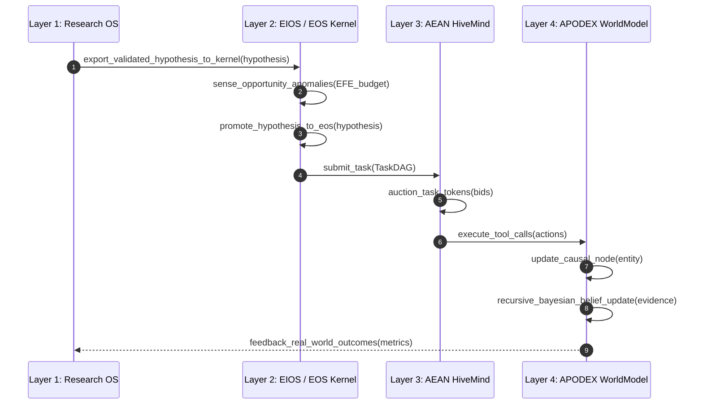

# Unified Cognitive Operating System Dependency Graph

## 1. System Interaction Architecture

The following dependency graph illustrates how data, hypotheses, tasks, and state flow bidirectionally across the 4 layers of the Unified Cognitive Operating System.

```
+-----------------------------------------------------------------------------------+
|                        LAYER 1: RESEARCH OS (Research Layer)                      |
|                                                                                   |
|  [Hypothesis Generator] --> [Literature Review Engine] --> [Statistical Validation] |
+-----------------------------------------------------------------------------------+
                                       |
                   (Validated Hypotheses & Insights)
                                       v
+-----------------------------------------------------------------------------------+
|                     LAYER 2: EIOS / EOS KERNEL (Orchestration Layer)              |
|                                                                                   |
|  [EIOS Active Inference Sensing] --> [EOS State Machine] --> [DAG Compiler]      |
+-----------------------------------------------------------------------------------+
                                       |
                          (Compiled Task DAG Nodes)
                                       v
+-----------------------------------------------------------------------------------+
|                   LAYER 3: AEAN HIVEMIND (Intelligence Layer)                     |
|                                                                                   |
|  [Token Bidding Auction] --> [Specialized Worker Agents] --> [Meta-Reasoner]      |
+-----------------------------------------------------------------------------------+
                                       |
                          (Actions & Tool Calls)
                                       v
+-----------------------------------------------------------------------------------+
|               LAYER 4: APODEX PLATFORM (World Model & Execution Layer)            |
|                                                                                   |
|  [APODEX WorldModel] <--> [CMOS Unified Memory] <--> [Skills & Safety Flywheel]   |
+-----------------------------------------------------------------------------------+
```

---

## 2. Mermaid Inter-Layer Sequence Diagram



---

## 3. Explicit Subsystem Dependency Mapping

| Source Layer / Subsystem | Target Layer / Subsystem | Interface Method / Function Call | Data Payload Transferred |
|---|---|---|---|
| **Layer 1: Research OS** | **Layer 2: EIOS Kernel** | `export_validated_hypothesis_to_kernel()` | `ValidatedHypothesis` (ID, metrics, EFE delta) |
| **Layer 1: Research OS** | **Layer 2: EOS Engine** | `promote_hypothesis_to_eos()` | `ResearchInsight` (Opportunity fit score, risk profile) |
| **Layer 2: EIOS Kernel** | **Layer 3: AEAN HiveMind** | `HiveMind.submit_task()` | `TaskDAGNode` (Task ID, required skills, token reward) |
| **Layer 3: AEAN HiveMind** | **Layer 4: APODEX WorldModel**| `WorldModel.add_causal_relation()` | `CausalRelation` (Cause ID, Effect ID, coefficient) |
| **Layer 3: AEAN HiveMind** | **Layer 4: CMOS Memory** | `CMOS.store_trajectory()` | `TrajectoryRecord` (States, actions, rewards, advantages)|
| **Layer 4: APODEX WorldModel**| **Layer 1: Research OS** | `ResearchOS.ingest_empirical_observation()` | `RealityObservation` (Observed metrics, residual error) |

---

## 4. Module Import & Calling Hierarchy

To enforce clean unidirectional dependency constraints and prevent circular imports:

1. `apodex.world_model`, `apodex.memory`, `apodex.execution`, `apodex.governance` (Layer 4) are foundational and DO NOT import higher layers.
2. `apodex.aean`, `apodex.cognition` (Layer 3) import Layer 4 modules for memory and world model queries.
3. `apodex.arcs`, `apodex.ai_eos.intelligence` (Layer 2) import Layer 3 and Layer 4 modules for DAG execution and world state checks.
4. `apodex.research_os`, `apodex.ai_eos.research` (Layer 1) import Layer 2, Layer 3, and Layer 4 interfaces via `ResearchToSystemBridge`.
