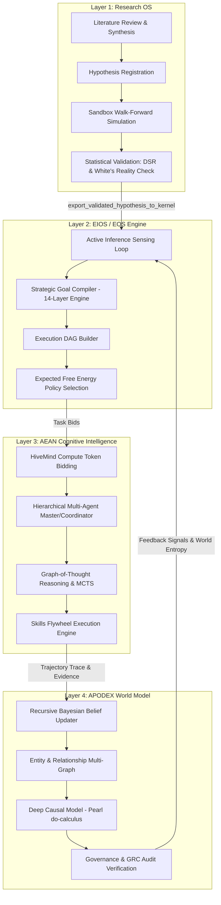

# Unified Cognitive Operating System Dependency Graph

**Author:** Jules (Autonomous System Engineer)
**Status:** Approved Architecture Standard

---

## 1. High-Level Subsystem Interaction Flow

The following diagram details the directional flow of scientific hypotheses, strategic goals, execution tasks, world state queries, and recursive belief updates across the 4 integrated layers of the Cognitive Operating System:

```
                  +----------------------------------------------+
                  |         LAYER 1: RESEARCH OS LAYER           |
                  | (Hypothesis Generation & Statistical Check) |
                  +----------------------------------------------+
                                         |
                                         | Validated Scientific
                                         | Hypotheses (DSR & WRC)
                                         v
                  +----------------------------------------------+
                  |       LAYER 2: EIOS / EOS ENGINE LAYER       |
                  |  (Active Inference Sensing & DAG Compiler)   |
                  +----------------------------------------------+
                                         |
                                         | Task Bids & Compiled
                                         | Execution DAG Nodes
                                         v
                  +----------------------------------------------+
                  |       LAYER 3: AEAN COGNITION LAYER          |
                  | (HiveMind Bidding, Swarm & Skills Execution) |
                  +----------------------------------------------+
                                         |
                                         | Action Trajectories,
                                         | Tool Evidence & Claims
                                         v
                  +----------------------------------------------+
                  |     LAYER 4: APODEX WORLD MODEL PLATFORM     |
                  | (Entity Graph, Bayesian Beliefs, GRC Audit)  |
                  +----------------------------------------------+
```

---

## 2. Detailed Data Handoff and Interface Protocol



---

## 3. Directional Module Call Hierarchy

| Source Layer & Module | Direction | Target Layer & Module | Interface Method / Protocol | Handoff Payload |
| :--- | :--- | :--- | :--- | :--- |
| **Layer 1:** `research_os.py` | $ \longrightarrow $ | **Layer 2:** `kernel.py` | `ResearchToSystemBridge.export_validated_hypothesis_to_kernel()` | Registered Hypothesis, P-value, Deflated Sharpe Ratio |
| **Layer 1:** `research_os.py` | $ \longrightarrow $ | **Layer 2:** `eos_engine.py` | `EOSEngine.ingest_validated_research()` | Validated scientific theory, effect size, statistical confidence |
| **Layer 2:** `kernel.py` | $ \longrightarrow $ | **Layer 3:** `hive_mind.py` | `HiveMind.arbitrate(bids)` | `TaskBid(task, priority, expected_value, token_cost)` |
| **Layer 3:** `hive_mind.py` | $ \longrightarrow $ | **Layer 3:** `hierarchical.py` | `HierarchicalOrchestrator.orchestrate()` | Granted task execution spec, role assignment |
| **Layer 3:** `hierarchical.py` | $ \longrightarrow $ | **Layer 4:** `beliefs.py` | `Belief.update_confidence()` | Likelihood score, prior probability, evidence hash |
| **Layer 4:** `beliefs.py` | $ \longrightarrow $ | **Layer 4:** `brain.py` | `CognitiveBrain.run_strategic_cycle()` | Bayesian belief state, Pearl do-calculus causal query |
| **Layer 4:** `brain.py` | $ \longrightarrow $ | **Layer 2:** `kernel.py` | `HierarchicalActiveInference.calculate_layer_free_energy()` | Variational Free Energy, world entropy, state feedback |

---

## 4. Active Inference Feedback Loops and State Verification

1. **Epistemic Feedback Loop:**
   - Unresolved uncertainty in Layer 4 World Model generates an epistemic curiosity demand signal.
   - Layer 2 Active Inference Planner routes curiosity demand to Layer 1 Research OS for literature review and hypothesis formulation.
2. **Pragmatic Feedback Loop:**
   - Layer 3 swarm action execution produces empirical outcomes.
   - Outcomes update Layer 4 Bayesian Belief distributions ($ P(B|E) $).
   - Reduced entropy stabilizes Layer 2 EIOS state machine transitions.
3. **Governance and Safety Guardrail:**
   - Before any Layer 3 action reaches Layer 4 persistence or real-world execution, Layer 4 Governance Framework evaluates Hendrycks safety constraints and GRC thresholds ($ \text{risk\_score} < 0.85 $).
