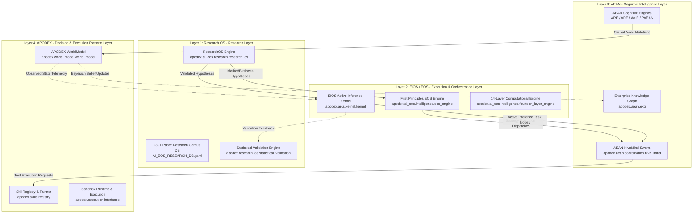

# Unified Dependency Graph & Contract Specification
**Author:** Jules (Autonomous System Architect)
**Status:** Canonical Architectural Dependency Graph
**Version:** 4.0.0 (2026 Edition)

---

## 1. High-Level Architectural Flow Graph

The dependency hierarchy strictly flows downwards in dependency order (Layer 4 -> Layer 3 -> Layer 2 -> Layer 1) for infrastructure and upwards for state notifications via event bus decoupling.



---

## 2. Textual ASCII Layer Topology

```
+-----------------------------------------------------------------------------------------+
| LAYER 4: APODEX DECISION & EXECUTION PLATFORM LAYER                                    |
| Modules: apodex.world_model.*, apodex.skills.*, apodex.execution.*                      |
| Functions: World Model Causal Nodes, Bayesian Belief updating, 60-Skill Registry,       |
|            Sandbox Execution, Compliance, Audit & Telemetry                            |
+-----------------------------------------------------------------------------------------+
                                           ^
                                           | Implements Execution & State Updates
+-----------------------------------------------------------------------------------------+
| LAYER 3: AEAN COGNITIVE INTELLIGENCE LAYER                                               |
| Modules: apodex.aean.coordination.*, apodex.aean.ekg, apodex.aean.engines.*              |
| Functions: HiveMind Token Bidding Auction, Multi-Agent Swarm Coordination, EKG Reasoning, |
|            Code/Plan Rewrites (ARE/ADE/AVIE/PAEAN), Epistemic Critics                   |
+-----------------------------------------------------------------------------------------+
                                           ^
                                           | Dispatches Strategy Execution Nodes
+-----------------------------------------------------------------------------------------+
| LAYER 2: EIOS / EOS EXECUTION & ORCHESTRATION LAYER                                     |
| Modules: apodex.arcs.kernel.kernel, apodex.ai_eos.intelligence.*                         |
| Functions: Active Inference EFE Sensing Kernel, First-Principles EOS State Machine,    |
|            14-Layer Computational Engine Pipeline, Capital Allocation & Portfolio       |
+-----------------------------------------------------------------------------------------+
                                           ^
                                           | Exports Validated Research Hypotheses
+-----------------------------------------------------------------------------------------+
| LAYER 1: RESEARCH OS (RESEARCH LAYER)                                                   |
| Modules: apodex.ai_eos.research.*, apodex.research_os.*                                 |
| Functions: Paper Corpus Mining (IDs 1-500), Literature Review Synthesis, Statistical     |
|            Validation (DSR/CDF/PPF), Hypothesis Generation & Transferable Principles    |
+-----------------------------------------------------------------------------------------+
```

---

## 3. Explicit Layer Interface Contracts

### 1. Layer 1 -> Layer 2 Handshake
```python
# Interface: ResearchOS -> EIOS Kernel & EOS Engine
hypothesis = research_os.conduct_literature_review("causal active inference")
kernel.register_research_hypothesis(
    hypothesis_id=hypothesis.id,
    title=hypothesis.title,
    epistemic_uncertainty=hypothesis.uncertainty_score
)
eos_engine.ingest_validated_research(hypothesis)
```

### 2. Layer 2 -> Layer 3 Handshake
```python
# Interface: EIOS/EOS -> AEAN HiveMind
task_dispatch = eos_engine.generate_task_dispatch(opportunity_id="OPP-101")
hive_mind.register_research_insight(
    insight_id=task_dispatch.id,
    content=task_dispatch.content,
    priority_weight=task_dispatch.efe_score
)
hive_mind.submit_task(task_dispatch)
```

### 3. Layer 3 -> Layer 4 Handshake
```python
# Interface: AEAN HiveMind -> APODEX Platform
skill = skill_registry.get_skill(task.skill_name)
execution_result = skill.execute(params=task.params)
world_model.update_bayesian_belief(
    belief_id=task.belief_id,
    evidence=execution_result.observation
)
```

---

## 4. Isolation & Decoupling Principles
1. **No Circular Imports:** Upper layers import lower layer protocol contracts; lower layers communicate with upper layers exclusively via `EventBus` signals or callbacks.
2. **Explicit Data DTOs:** All cross-layer payloads are validated Pydantic V2 models (`BaseModel` / `ConfigDict`).
3. **Stateless Service Boundaries:** Components maintain local immutability; persistent state resides in canonical databases (`SQLModel` / `WorldModel`).
