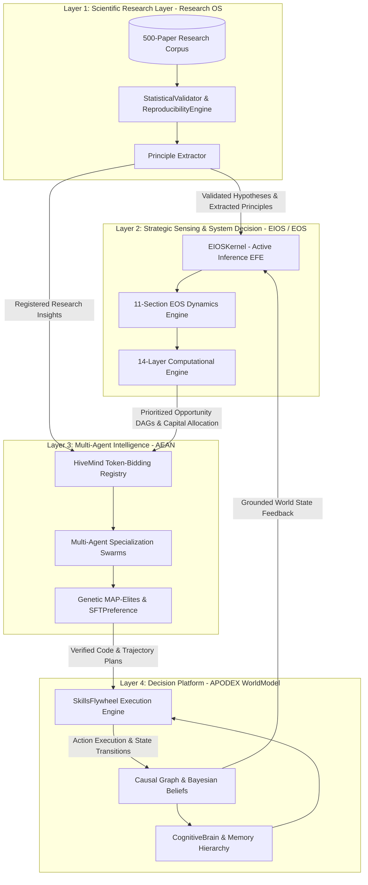

# Unified Cognitive Operating System Dependency Graph

## 1. Inter-Layer Dependency Diagram (Mermaid)

---

## 2. Layer Data Artifact & Interface Dependency Matrix

| Source Layer | Target Layer | Data Artifact / Interface | Transport Mechanism | Synchronicity |
| :--- | :--- | :--- | :--- | :--- |
| **Layer 1** | **Layer 2** | `ValidatedHypothesis` | `export_validated_hypothesis_to_kernel()` | Asynchronous Event |
| **Layer 1** | **Layer 3** | `CorpusPrinciple` | `register_301_500_paper_corpus_principles()` | In-Memory Index |
| **Layer 1 / 2** | **Layer 3** | `ResearchToSystemBridge` | `bridge_research_to_system_state()` | Orchestrated Handoff |
| **Layer 2** | **Layer 3** | `OpportunityDAG` | `ingest_opportunity_dag()` | Active Inference Queue |
| **Layer 3** | **Layer 4** | `SwarmTrajectoryPlan` | `submit_agent_plan()` | Token Bidding Protocol |
| **Layer 4** | **Layer 2** | `WorldStateObservation` | `sense_opportunity_anomalies()` | Active Inference Sensor |
