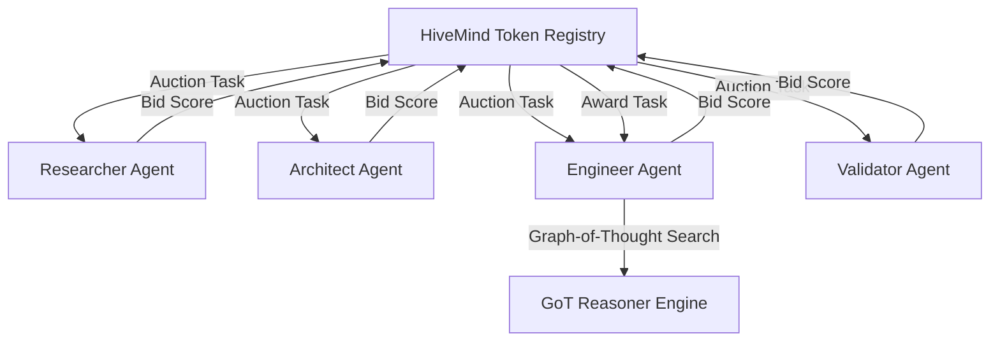

# Unified Cognitive Operating System Dependency Graph & Interface Topology

## 1. Executive Summary & Layer Topology

This document specifies the exact dependency graph, control flows, data handoffs, and event protocols governing inter-layer communication within the unified cognitive operating system (Research OS, EIOS/EOS, AEAN, APODEX).

---

## 2. Comprehensive Inter-Layer Dependency Diagram

```
+-------------------------------------------------------------------------------------------------+
|                                LAYER 1: RESEARCH OS (Research Layer)                            |
|  [ResearchOS] <---> [StatisticalValidator] <---> [CodeRewriteEngine] <---> [500-Paper Corpus]   |
+-------------------------------------------------------------------------------------------------+
          ^ (Epistemic Anomaly & Revalidation Requests)            | (Validated Hypotheses & Principles)
          |                                                       v
+-------------------------------------------------------------------------------------------------+
|                        LAYER 2: EIOS / EOS (Execution & Orchestration Layer)                   |
|  [EIOSKernel (EFE Sensing)] <---> [EOSEngine (State Machine)] <---> [14-Layer Computational Engine]|
+-------------------------------------------------------------------------------------------------+
          ^ (Belief Updates & Reality Anomalies)                  | (Strategic Intent & Opportunity DAGs)
          |                                                       v
+-------------------------------------------------------------------------------------------------+
|                             LAYER 3: AEAN (Cognitive Intelligence Layer)                        |
|  [HiveMind (Token Bidding)] <---> [CognitiveBrain] <---> [GoT Reasoner] <---> [WorkflowOptimizer]|
+-------------------------------------------------------------------------------------------------+
          ^ (Execution Outcomes & Performance Metrics)            | (Task Dispatch & Skill Calls)
          |                                                       v
+-------------------------------------------------------------------------------------------------+
|                    LAYER 4: APODEX (Decision & Execution Platform Layer)                        |
|  [WorldModel (Causal Graph)] <---> [SkillRegistry (60 Skills)] <---> [SafetyCore / Guardrails]  |
+-------------------------------------------------------------------------------------------------+
```

---

## 3. Directional Handoff Protocols

### 3.1 Downward Control Handoffs (Strategy to Execution)

1. **Layer 1 -> Layer 2 (Hypothesis Promotion)**:
   - *Source*: `apodex.ai_eos.research.research_os.ResearchOS`
   - *Target*: `apodex.arcs.kernel.kernel.EIOSKernel` / `apodex.ai_eos.intelligence.eos_engine.EOSEngine`
   - *Bridge Method*: `ResearchToSystemBridge.promote_hypothesis_to_eos(hypothesis)`
   - *Contract*: Validated research hypotheses with $p < 0.05$, epistemic uncertainty $\sigma^2$, and transferable code principles are registered into Layer 2 active hypotheses registry.

2. **Layer 2 -> Layer 3 (Opportunity DAG Dispatch)**:
   - *Source*: `apodex.ai_eos.intelligence.eos_engine.EOSEngine`
   - *Target*: `apodex.aean.coordination.hive_mind.HiveMind`
   - *Bridge Method*: `HiveMind.register_research_insight(insight_payload)`
   - *Contract*: EOS state transitions generate an `OpportunityDAGContract` containing subtask descriptions, expected free energy bounds, cost budgets, and SLA constraints.

3. **Layer 3 -> Layer 4 (Skill Execution Dispatch)**:
   - *Source*: `apodex.aean.coordination.hive_mind.HiveMind` / `agent_harness.core.runtime.orchestration.hierarchical`
   - *Target*: `apodex.skills.runner.SkillRunner` / `apodex.world_model.world_model.WorldModel`
   - *Bridge Method*: `SkillRunner.execute_skill(skill_name, parameters)`
   - *Contract*: The winning bidding agent dispatches standardized `SkillExecutionTask` payloads referencing one of the 60 canonical skills registered in `SkillRegistry`.

---

### 3.2 Upward Sensing & Feedback Loops (Observation to Hypothesis)

1. **Layer 4 -> Layer 3 (State & Action Feedback)**:
   - *Source*: `apodex.world_model.world_model.WorldModel`
   - *Target*: `agent_harness.core.memory.learning_memory.LongTermLearningMemory`
   - *Contract*: Environment responses, skill execution trajectories, and cost-tier utilization are fed back to update agent action weights and trajectory memories.

2. **Layer 3 -> Layer 2 (Active Learning Anomaly Sensing)**:
   - *Source*: `agent_harness.core.runtime.reasoning.active_learning.ActiveLearningEngine`
   - *Target*: `apodex.arcs.kernel.kernel.EIOSKernel`
   - *Bridge Method*: `EIOSKernel.sense_opportunity_anomalies(world_state_delta)`
   - *Contract*: High epistemic variance or unexpected contradiction flags trigger Active Inference re-calculation of Expected Free Energy across active business opportunities.

3. **Layer 2 -> Layer 1 (Epistemic Re-validation Request)**:
   - *Source*: `apodex.arcs.kernel.kernel.EIOSKernel`
   - *Target*: `apodex.ai_eos.research.research_os.ResearchOS`
   - *Bridge Method*: `ResearchOS.conduct_literature_review(query)`
   - *Contract*: Persistent anomaly detection in Layer 2 forces Layer 1 to re-query the 500-paper corpus and execute literature-backed scientific experiments to update foundational hypotheses.

---

## 4. Lateral Swarm Topology (AEAN Layer 3)

Inside Layer 3, agents communicate via a decentralized token-bidding mesh managed by `HiveMind`:



### Bidding Mechanism Formula
Each agent $i$ computes its bid $B_i$ for subtask $T$:
$$B_i = w_{\text{skill}} \cdot S_i(T) + w_{\text{epistemic}} \cdot (1 - \sigma_i^2) - w_{\text{cost}} \cdot C_i$$
Where:
- $S_i(T) \in [0,1]$ is agent $i$'s skill alignment score.
- $\sigma_i^2$ is epistemic uncertainty on task domain.
- $C_i$ is estimated compute cost tier.

---

## 5. Event-Driven Messaging vs. Direct Sync Bridges

| Interface Channel | Protocol Type | Latency Budget | Delivery Guarantee | Use Case |
| :--- | :--- | :--- | :--- | :--- |
| **Research OS -> EOS Bridge** | Direct Sync | < 50ms | At-least-once | Hypothesis promotion & literature lookup |
| **EIOS EFE Sensing Loop** | Async Event Bus | < 100ms | Exactly-once | Opportunistic anomaly sensing & state machine updates |
| **HiveMind Swarm Bidding** | Memory Channel | < 20ms | At-most-once | Token bidding & worker task allocation |
| **APODEX Skill Execution** | Direct Process Call | < 500ms | Exactly-once | Execution of code rewrites, protocols, world model updates |
| **Credit Halt Guardrails** | Synchronous Gate | < 5ms | Fail-closed | Hard safety halt when budget threshold breached |

---

## 6. Dependency Conformance Verification

To enforce zero architectural drift and strictly maintain layer isolation, all module imports must conform to the strict single-direction dependency rule:
- `apodex.ai_eos.research` MUST NOT import from `apodex.world_model` or `apodex.aean`.
- `apodex.arcs.kernel` MAY import from `apodex.ai_eos.research`.
- `apodex.aean` MAY import from `apodex.ai_eos` and `apodex.arcs`.
- `apodex.world_model` MUST NOT import higher-layer orchestration logic directly, communicating only via standardized protocol data contracts.
